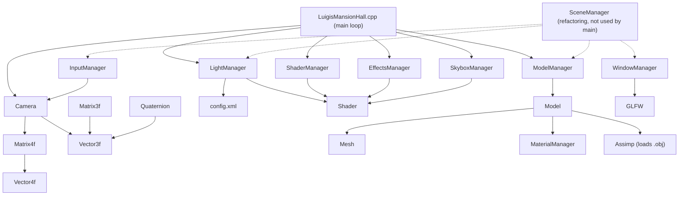

# Luigi's Mansion Hall: Codebase Wiki

> Map of the sources in `src/` and `include/` (about 4,900 lines of C++ plus the generated
> `glad.c`, and 17 GLSL shaders). It helps you see at a glance which file you are looking at,
> what each one does and who depends on whom.
> Last updated: 25 Oct 2026.

Luigi's Mansion Hall is a real-time 3D scene in **C++ and OpenGL 3.3 (core profile)**: a
walkable recreation of the atmospheric hall from Luigi's Mansion, with a moonlit night sky,
blue candle lights, a floating Boo ghost and a dirty glass doorway that works as a mirror.
It was a **group university project** (computer graphics course) and Renato's **first
experience with C++ and OpenGL**.

His part: the core application, the GLSL shaders and most of the linear algebra library, which
is **written from scratch instead of using a standard library such as GLM**.

---

## 1. How to build and run

Requirements: Windows, Visual Studio 2022 (*Desktop development with C++*), a GPU supporting
OpenGL 3.3.

1. Open `LuigisMansionHall.sln`.
2. Select **Debug** and **x64**.
3. Press **F5**.

GLFW and Assimp are in `third_party/`. A post-build step copies `assimp-vc143-mt.dll` next to
the executable. Run it with the project folder as the working directory, because shaders,
models and `config.xml` are loaded with relative paths.

### Controls
| Input | Action |
|---|---|
| W A S D | Move the camera |
| Space / Left Shift | Move up / down |
| Mouse | Look around |
| P | Pause (releases the mouse cursor) |
| Esc | Exit |

A camera HUD (position and rotation) is printed in the console and refreshed at a fixed interval.

---

## 2. Layered architecture

| Layer | What it does | Files |
|---|---|---|
| **Entry point and main loop** | Window, callbacks, per-frame update and draw | `core/LuigisMansionHall.cpp` |
| **Math library (from scratch)** | Vectors, matrices, quaternions, camera | `core/math/*`, `include/math/*` |
| **Rendering** | Shaders, models/meshes, materials, skybox | `rendering/*`, `include/rendering/*` |
| **Managers** | Window, input, models, lighting, scene | `managers/*` |
| **Effects** | Dirty glass mirror | `effects/EffectsManager.*` |
| **Data** | Window settings, lights, skybox, materials | `config.xml` |
| **Shaders** | GLSL programs | `assets/shaders/*` |

---

## 3. Dependency graph



Note: `SceneManager`, `WindowManager` and `InputManager` form a more modular version of the
setup that is in `LuigisMansionHall.cpp`. Nothing outside `SceneManager` itself uses
`SceneManager`: the live program still runs from the `main()` in `LuigisMansionHall.cpp`.

---

## 4. File by file

### `core/LuigisMansionHall.cpp` (444 lines)
Contains `main()`. Creates the GLFW window (OpenGL 3.3 core), initialises the managers, loads
`config.xml` and then runs the loop: `processInput`, update effects (Boo "breathing" and a
bioluminescence timer), draw skybox, models, Boo and the mirror. Helper functions set the
common shader uniforms (camera position, lights, skybox IBL, model/view/projection matrices).
Global state includes the camera, the managers and the effect timers.

### Math library (`core/math/` and `include/math/`)
Written from scratch.
- `Vector3f`, `Vector4f`: vectors with the usual operators, dot and cross products, normalisation.
- `Matrix3f`, `Matrix4f`: operators, determinant, transpose, cofactors/inverse for
  `Matrix4f`, and the transformations `projection(...)` and `lookAt(eye, target, up)`.
- `Quaternion`: construction from angle and axis, multiplication, conjugate, inverse,
  normalisation.
- `Camera`: first-person camera with position, look-at point, field of view, near/far planes,
  `move('W'/'A'/'S'/'D'/'U'/'N', dt)`, rotations around X and Y, and view/projection matrices.

### Rendering (`rendering/` and `include/rendering/`)
- `Shader`: reads, compiles and links a vertex and fragment shader, with `setBool/Int/Float`
  and vector/matrix uniforms, and compile error reporting.
- `ShaderManager`: static registry that returns the right shader for a material type
  (Phong or Lambert), for a light type or for the mirror.
- `Model` (583 lines in the `.cpp`): loads `.obj` files through **Assimp**, walks the node tree
  (`processNode`, `processMesh`), builds `Mesh` objects with vertices, indices and textures,
  and loads textures from files.
- `MaterialManager` / `MaterialProperties`: predefined Phong and Lambert materials (ambient,
  diffuse, specular, shininess). Materials from the XML are matched by name.
- `SkyboxManager`: generates a **procedural night sky cubemap** and draws it; the same cubemap
  is used for **image-based lighting (IBL)** at a configurable strength.
- `glad.c`: OpenGL function loader (generated).

### Managers (`managers/`)
- `LightManager` (443 lines): reads lights from `config.xml` (ambient, one directional "moon"
  light, point lights for the candelabra, a dynamic Boo light, optional spot lights) and sends
  them to the shaders. Point lights have a "breathing" intensity animation (speed, min, max).
- `ModelManager`: tries several relative paths for each model (so it works from different
  working directories), loads all models and draws them.
- `WindowManager`: GLFW window creation and callbacks. `InputManager`: keyboard/mouse handling
  and the camera HUD. `SceneManager`: unified scene setup and render calls (see the note above).

### Effects (`effects/EffectsManager.*`)
Draws the **dirty glass doorway**: a quad with a procedurally generated dirty-glass texture,
rendered with the mirror shader, which also takes a time uniform and a `ghostEffect` value.

### Shaders (`assets/shaders/`)
| Files | Role |
|---|---|
| `phong.frag`, `simple_phong.*` | Phong lighting (ambient + diffuse + specular) |
| `lambert.frag` | Diffuse-only lighting |
| `multi_light.*`, `model.*` | Several lights at once, including mirrored copies of the lights for the mirror |
| `directional_light.frag`, `point_light.frag` | Single-light variants (point lights with attenuation) |
| `skybox.*` | Skybox drawing |
| `mirror.*` | Dirty glass / mirror effect |
| `debug.*`, `common.vert` | Debug and shared vertex code |

---

## 5. Configuration (`config.xml`)

| Section | Content |
|---|---|
| `Scene/Camera` | Start position, target, field of view (60), speed (15) |
| `Lighting` | Ambient light, moonlight (directional), 6 blue candelabra point lights with attenuation, Boo light, skybox type and IBL strength |
| `Materials` and `Textures` | Per-material type (`phong` or `lambert`) and texture assignments (about 35 materials) |
| `Settings` | Window 1920 x 1080, mouse sensitivity, movement speed, VSync, MSAA x4 |

Changing the look of the hall (light colours, strengths, materials) needs no recompilation.

---

## 6. Folder layout

```
lugis-mansion-hall/
  LuigisMansionHall.sln / .vcxproj
  config.xml
  src/
    core/          # main loop and math library
    rendering/     # Shader, Model, SkyboxManager, glad
    managers/      # window, input, models, lighting, scene
    effects/
  include/         # headers for math and rendering
  assets/
    models/        # .obj/.mtl and textures
    shaders/       # GLSL
  third_party/     # GLFW and Assimp headers and libraries
  docs/CODEBASE.md
```
